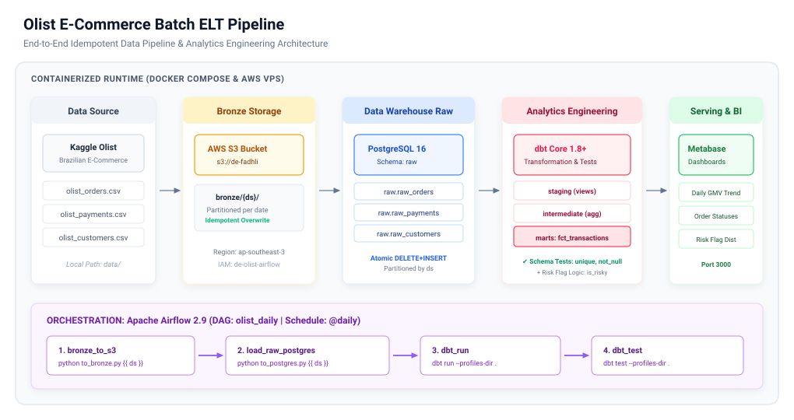

# Olist E-Commerce Batch ELT Pipeline

[](https://airflow.apache.org/)
[](https://www.getdbt.com/)
[](https://www.postgresql.org/)
[](https://aws.amazon.com/s3/)
[](https://www.docker.com/)
[](https://www.metabase.com/)

An end-to-end, production-grade batch ELT data pipeline built to ingest, model, test, and serve Brazilian e-commerce transaction data. Demonstrates cloud storage partitioning, atomic idempotency, dimensional analytics engineering, and business risk profiling.

---

## 🏛️ Architecture Overview



> 💡 *Interactive / editable diagram: [`docs/architecture.drawio`](docs/architecture.drawio) (can be opened directly in [draw.io](https://app.diagrams.net/)).*

### End-to-End Pipeline Flow

```
[ Kaggle CSVs ] ──▶ [ AWS S3 Bronze ] ──▶ [ PostgreSQL Raw ] ──▶ [ dbt Modeling ] ──▶ [ Metabase BI ]
  (data/*.csv)       (s3://.../bronze/)      (schema: raw)        (staging/marts)       (Port 3000)
```

1. **Bronze Ingestion (`to_bronze.py`)**:
   - Ingests local raw CSVs (`orders`, `payments`, `customers`) into **AWS S3** under date partitions `bronze/{ds}/`.
   - **Idempotency**: Existing keys are overwritten, preventing orphan files during re-runs.
2. **Warehouse Ingestion (`to_postgres.py`)**:
   - Reads bronze CSV data from S3 and streams it into PostgreSQL `raw` schema.
   - **Atomic Partition Reload**: Runs `DELETE FROM raw.<table> WHERE ds = %s` followed by parameterized batch `INSERT`, guaranteeing zero duplicates on retries or historical backfills.
3. **Analytics Engineering (`dbt Core`)**:
   - **Staging (`stg_*`)**: Casts data types, standardizes column naming, and creates clean views on top of raw tables.
   - **Intermediate (`int_transactions`)**: Solves the **1:N payment split problem** by aggregating multiple payment methods and installments per `order_id` before joining with orders.
   - **Marts (`fct_transactions`)**: Materialized table containing transaction metrics enriched with banking/fintech **risk indicators** (`is_risky`).
   - **Automated Data Quality Tests**: Validates `unique`, `not_null`, and `accepted_values` rules across staging and mart models on every run.
4. **BI & Analytics Serving (`Metabase`)**:
   - Serves analytical dashboards tracking daily GMV trends, order status distributions, and high-risk transaction alerts.
5. **Orchestration (`Apache Airflow`)**:
   - Daily schedule (`@daily`), executing: `bronze_to_s3 >> load_raw_postgres >> dbt_run >> dbt_test`.

---

## 🎯 Key Data Engineering Highlights

* **Atomic Idempotency & Backfill Safety**:
  Every stage is partitioned by execution date (`ds`). Rerunning the DAG for any historical date will cleanly overwrite S3 keys and replace the matching Postgres partition without accumulating duplicate records.
* **Grain Integrity & Reconciliation (1:N Handling)**:
  In e-commerce datasets, orders often have multiple split payments (e.g. credit card + voucher). `int_transactions` reconciles payments at the order grain first (`SUM(payment_value)`, `MAX(installments)`), preventing row duplication and metric inflation in downstream marts.
* **Domain-Specific Risk Scoring**:
  Implements realistic financial risk logic:
  ```sql
  ((coalesce(installments, 0) >= 10 or (payment_type = 'voucher' and payment_value > 500))) as is_risky
  ```
  Flags transactions with extreme installment plans (&ge; 10) or unusually large voucher redemptions for fraud/credit analysis.
* **Data Quality as Code**:
  Built-in dbt schema tests enforce data integrity before data hits the BI layer. Pipeline alerts immediately if primary keys duplicate or order statuses breach schema constraints.
* **Production Container Optimization**:
  Dependencies are packaged via a custom `Dockerfile` (`apache/airflow:2.9.3-python3.11` + `requirements.txt`) rather than installing packages on container boot, eliminating startup latency and PyPI download failures.

---

## 📊 Data Modeling & Mart Lineage

```
raw.raw_orders ──────▶ stg_orders ───────┐
                                         ├──▶ int_transactions ──▶ fct_transactions
raw.raw_payments ────▶ stg_payments ─────┘
```

### Fact Table Schema (`marts.fct_transactions`)

| Column Name | Data Type | Description |
| :--- | :--- | :--- |
| `order_id` | `VARCHAR` | Primary key (unique order identifier) |
| `customer_id` | `VARCHAR` | Foreign key referencing customer |
| `order_status` | `VARCHAR` | Status (`delivered`, `shipped`, `canceled`, etc.) |
| `payment_type` | `VARCHAR` | Primary payment method (`credit_card`, `boleto`, `voucher`) |
| `payment_value` | `NUMERIC` | Total order payment amount (BRL) |
| `is_risky` | `BOOLEAN` | Risk flag (&ge; 10 installments or voucher > 500 BRL) |
| `txn_date` | `DATE` | Truncated transaction date (for daily aggregations) |

---

## 🛠️ Tech Stack

| Component | Technology | Purpose |
| :--- | :--- | :--- |
| **Orchestration** | Apache Airflow 2.9 (LocalExecutor) | DAG scheduling, backfilling, and task dependency management |
| **Data Lake** | AWS S3 (`ap-southeast-3`) | Partitioned cloud object storage for raw/bronze layer |
| **Data Warehouse** | PostgreSQL 16 | Relational store for raw data tables and materialized marts |
| **Transformation** | dbt Core 1.8+ (`dbt-postgres`) | SQL dimensional modeling, Jinja macros, and schema testing |
| **Serving / BI** | Metabase | Business intelligence reporting and exploratory dashboards |
| **Infrastructure** | Docker & Docker Compose | Multi-service orchestration and containerized runtime |

---

## 📁 Repository Structure

```
.
├── dags/
│   └── olist_daily.py          # Airflow DAG definition (bronze -> raw -> dbt)
├── dbt/
│   ├── dbt_project.yml         # dbt project configurations and schema mapping
│   ├── profiles.yml            # Environment-aware Postgres profile
│   └── models/
│       ├── staging/            # Staging views (stg_orders, stg_payments)
│       ├── intermediate/       # Grain alignment & aggregations (int_transactions)
│       └── marts/              # Fact tables (fct_transactions) & test assertions
├── docs/
│   ├── architecture.drawio     # Editable Draw.io architecture diagram
│   └── architecture.svg        # Architecture SVG diagram preview
├── ingest/
│   ├── to_bronze.py            # Local CSV -> AWS S3 Bronze partition
│   └── to_postgres.py          # S3 Bronze -> PostgreSQL raw tables (idempotent)
├── .env.example                # Sample environment configurations
├── .gitignore                  # Git hygiene rules (caches, credentials, data ignored)
├── Dockerfile                  # Custom Airflow image with pre-baked dependencies
├── docker-compose.yml          # Services config (PostgreSQL, Airflow, Metabase)
├── requirements.txt            # Python dependencies (dbt-postgres, boto3, pandas)
└── README.md
```

---

## 🚀 Quickstart Guide

### 1. Prerequisites
- Docker Engine & Docker Compose installed.
- AWS Account with an S3 Bucket and IAM user (`AmazonS3FullAccess` or scoped bucket permissions).
- Brazilian E-Commerce dataset from [Kaggle](https://www.kaggle.com/datasets/olistbr/brazilian-ecommerce).

### 2. Environment Configuration
Clone the repository and copy the environment template:
```bash
cp .env.example .env
```
Fill in your credentials in `.env`:
```env
AWS_ACCESS_KEY_ID=your_aws_access_key
AWS_SECRET_ACCESS_KEY=your_aws_secret_key
AWS_REGION=ap-southeast-3
S3_BUCKET=your-s3-bucket-name

POSTGRES_USER=de
POSTGRES_PASSWORD=your_secure_password
POSTGRES_DB=olist
```

### 3. Place Raw Data
Create a `data/` folder at the project root and place the downloaded CSV files:
- `data/olist_orders_dataset.csv`
- `data/olist_order_payments_dataset.csv`
- `data/olist_customers_dataset.csv`

### 4. Build and Run Containers
```bash
docker compose up -d --build
```

### 5. Execute Pipeline & Verify
1. **Airflow UI**: Open [http://localhost:8080](http://localhost:8080) (`admin` / `admin`).
   - Unpause DAG `olist_daily` and trigger a run.
   - Monitor the 4 tasks: `bronze_to_s3 >> load_raw_postgres >> dbt_run >> dbt_test`.
2. **Postgres Verification**:
   ```bash
   docker compose exec postgres psql -U de -d olist -c "
   SELECT txn_date, COUNT(*) AS orders, ROUND(SUM(payment_value), 2) AS gmv,
          COUNT(*) FILTER (WHERE is_risky) AS risky_orders
   FROM marts.fct_transactions
   GROUP BY 1 ORDER BY 1 DESC LIMIT 5;
   "
   ```
3. **Metabase BI**: Open [http://localhost:3000](http://localhost:3000).
   - Connect PostgreSQL (`host: postgres`, `port: 5432`, `database: olist`).
   - Query table `marts.fct_transactions` to build dashboards.

---

## ⚖️ Architecture Trade-offs & Production Considerations

* **PostgreSQL vs. Cloud Data Warehouses (BigQuery / Snowflake)**:
  * For datasets < 10M rows, PostgreSQL provides excellent performance, zero cloud compute costs, and minimal operational overhead.
  * **Upgrade Path**: Because dbt abstracts SQL transformations, migrating to BigQuery, Snowflake, or Redshift only requires changing `profiles.yml` without refactoring modeling logic.
* **Real AWS S3 vs. MinIO**:
  * Chose real AWS S3 (`ap-southeast-3` Jakarta) to demonstrate cloud IAM role handling, bucket security policies, and production partitioning. Total AWS cost for this project is < $0.50/month.
* **Custom Dockerfile vs. Runtime `pip install`**:
  * Baking Python packages (`dbt-postgres`, `boto3`, `pandas`) directly into the Docker image prevents startup timeouts and eliminates dependencies on external network stability during container boot.

---

## 👤 Author

**Fadhli Syihabuddin**  
*Data Engineer*  
- LinkedIn: [linkedin.com/in/fadhli-syihabuddin-279a5a219](https://linkedin.com/in/fadhli-syihabuddin-279a5a219)
- GitHub: [@Fadhlisyihabuddin](https://github.com/Fadhlisyihabuddin)
